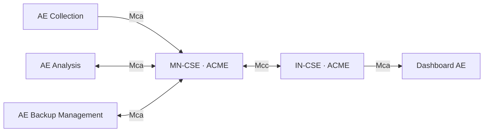

# QuietFix

oneM2M-based industrial equipment monitoring and per-machine anomaly detection prototype.
The current implementation is maintained on **`main`**. It collects temperature, vibration, and current,
and combines a separate Isolation Forest model for each machine with safety thresholds.

Project article: [QuietFix: oneM2M Industrial AI Monitoring on Hackster.io](https://www.hackster.io/558031/quietfix-onem2m-industrial-ai-monitoring-d3abe1)

## Architecture and Data Flow

- Raw readings and analysis results are stored in MN-CSE. Central-copy requests from the backup management AE pass through MN-CSE to IN-CSE over Mcc.
- The IN archive is an AE resource for storage. There is no separate archive program.
- Subscriptions and notifications trigger analysis and backup; reconciliation queries handle missed notifications. The dashboard retrieves the latest values through a central group.
- Per-machine models require explicit training. Machines without models indicate that preparation is required and retain threshold monitoring.
- MEC and Kubernetes are not used. The backup management AE uses the Mcc path in place of the former forwarder.

## Installation and Execution

Follow the **[deployment guide](docs/DEPLOYMENT.md)** to prepare a new Linux environment, train ML models, start, stop, and restart services.
The guide distinguishes basic eight-machine monitoring from a two-machine ML training and anomaly demonstration.
The default deployment is a single-host development configuration using loopback HTTP.

| Path | Purpose |
|---|---|
| `apps/` | Collection, analysis, backup management, dashboard, and shared oneM2M modules |
| `standalone/` | Standalone ACME preparation, execution, service management, and live CSE verification |
| `models/` | oneM2M FlexContainer definitions; separate from trained ML models |
| `test_data/` | Synthetic data for eight-machine monitoring, dynamic registration, and collection intervals |
| `tests/` | Regression tests and optional integration/UI tests |
| `security/` | Optional TLS and MQTT authentication configuration examples |
| `docs/` | Deployment procedures, validation records, and release information |

## Validation and Detailed Documentation

- [Validation records and reproduction commands](docs/VALIDATION.md)
- [Per-machine ML training, evaluation, and limitations](apps/ML.md)
- [Resource tree and application settings](apps/README.md)
- [Standalone CSE operation](standalone/README.md)
- [Access control](apps/ACP.md), [MQTT](apps/MQTT.md), [TLS](security/README.md)
- [FlexContainer](apps/FLEX.md), [semantic information](apps/SEMANTICS.md), [planned CSE transfer](apps/HANDOVER.md)

## oneM2M Usage

oneM2M handles device/application registration, standard resource storage, subscriptions, notifications,
group queries, and inter-CSE forwarding, allowing each AE to focus on collection, analysis, or backup.

- [oneM2M](https://www.onem2m.org/)
- [ACME CSE implementation](https://github.com/ankraft/ACME-oneM2M-CSE)

This prototype uses synthetic sensors. Its failure-prediction performance on real equipment has not been validated.

## Release

See [release information](docs/RELEASE.md) for the release contents and supported scope.
Environment files, databases, private keys, runtime logs, and trained models are excluded from Git.
