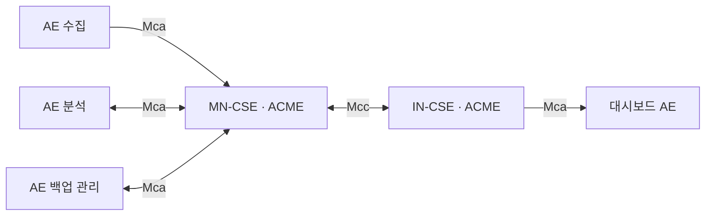

# QuietFix

oneM2M 기반 산업 설비 모니터링과 머신별 이상 탐지 프로토타입입니다.
최종 구현 브랜치는 **`onem2m-only`**입니다. 온도·진동·전류를 수집하고,
머신별 Isolation Forest와 안전 임계값을 함께 사용합니다.

## 구성과 데이터 흐름

- 원본과 분석 결과는 MN-CSE에 저장합니다. AE 백업 관리의 중앙 사본 요청은 MN-CSE에서 Mcc를 통해 IN-CSE로 전달됩니다.
- IN의 archive는 저장용 AE 리소스입니다. 별도 archive 프로그램은 없습니다.
- 구독·알림으로 분석과 백업을 실행하고, 보완 조회로 누락을 처리합니다. 대시보드는 중앙 그룹의 최신값을 조회합니다.
- 머신별 모델은 명시적으로 학습합니다. 모델이 없는 머신은 준비 필요 상태로 표시하고 임계값 감시를 유지합니다.
- MEC·Kubernetes는 사용하지 않습니다. 기존 전달기 대신 AE 백업 관리가 Mcc 경로를 사용합니다.

## 설치와 실행

새 Linux 환경의 준비, ML 학습, 실행, 종료, 재시작은 **[배포 가이드](docs/DEPLOYMENT.md)**를 따르세요.
기본 8대 모니터링과 머신 2대의 학습·이상 시연을 구분해 안내합니다.
기본 배포는 단일 호스트 loopback HTTP 개발 구성입니다.

| 경로 | 역할 |
|---|---|
| `apps/` | AE 수집·분석·백업 관리, 대시보드 및 oneM2M 공통 모듈 |
| `standalone/` | 독립 ACME 준비·실행·전체 서비스 관리·실제 CSE 검증 |
| `models/` | oneM2M FlexContainer 정의. 학습된 ML 모델과 구분 |
| `test_data/` | 기본 8대·동적 등록·수집 주기 시연용 합성 데이터 |
| `tests/` | 회귀 테스트와 선택적 통합/UI 테스트 |
| `security/` | 선택적 TLS·MQTT 인증 설정 예제 |
| `docs/` | 배포 절차·검증 기록·배포본 정보 |

## 검증과 상세 문서

- [검증 기록과 재현 명령](docs/VALIDATION.md)
- [머신별 ML 학습·평가와 한계](apps/ML.md)
- [리소스 트리와 앱 설정](apps/README.md)
- [독립 CSE 운영](standalone/README.md)
- [접근 제어](apps/ACP.md), [MQTT](apps/MQTT.md), [TLS](security/README.md)
- [FlexContainer](apps/FLEX.md), [의미 정보](apps/SEMANTICS.md), [계획된 CSE 전환](apps/HANDOVER.md)

## oneM2M 활용

장치·앱의 등록, 표준 리소스 저장, 구독·알림, 그룹 조회, CSE 간 요청 전달을
oneM2M에 맡겨 각 AE가 수집·분석·백업 역할에 집중하도록 구성했습니다.

- [oneM2M](https://www.onem2m.org/)
- [ACME CSE 구현](https://github.com/ankraft/ACME-oneM2M-CSE)

합성 센서를 사용하는 프로토타입이며 실제 설비의 고장 예측 성능을 검증한 제품은 아닙니다.

## 배포본

배포본의 구성과 지원 범위는 [배포본 정보](docs/RELEASE.md)에 정리되어 있습니다.
환경 파일·DB·개인키·실행 로그·학습 모델은 Git에서 제외합니다.
